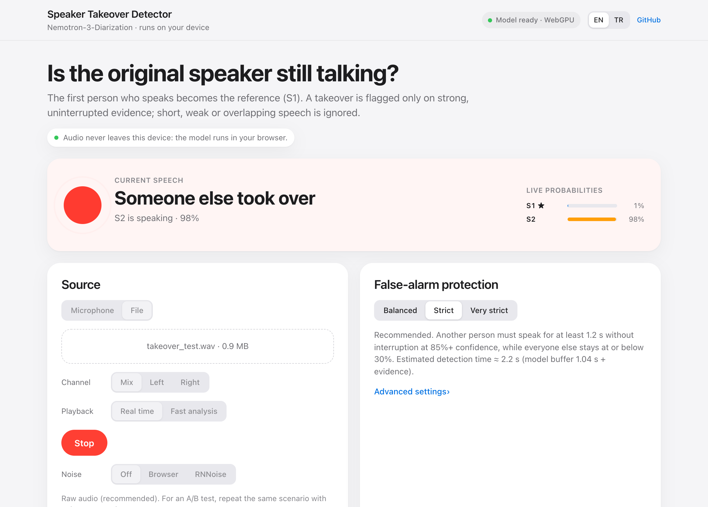
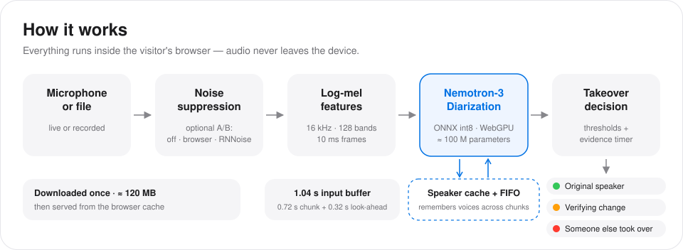
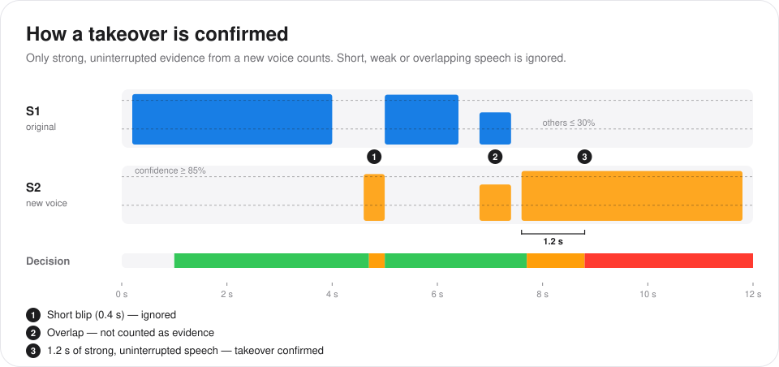
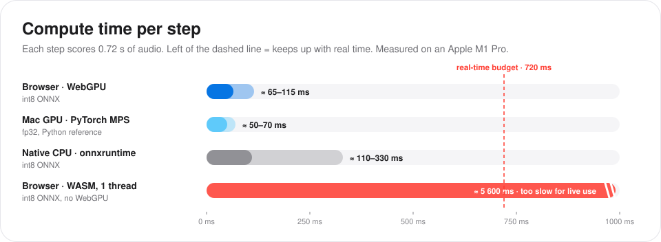
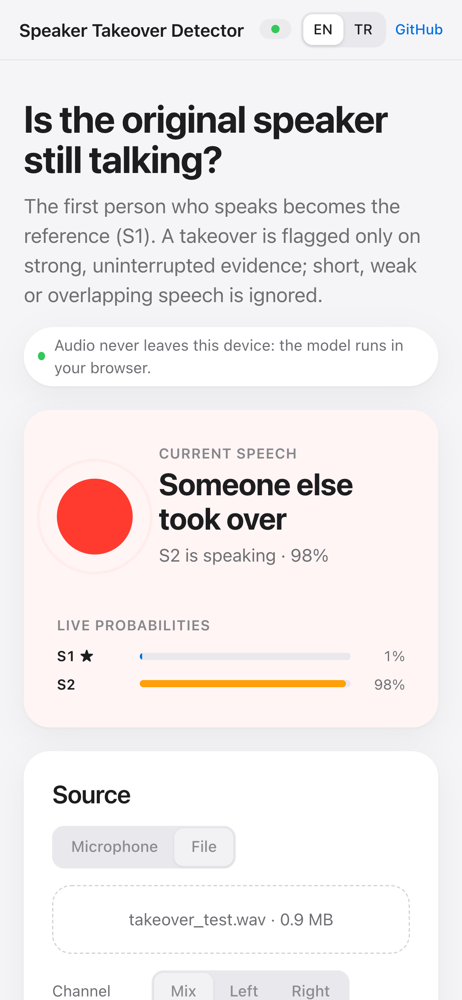
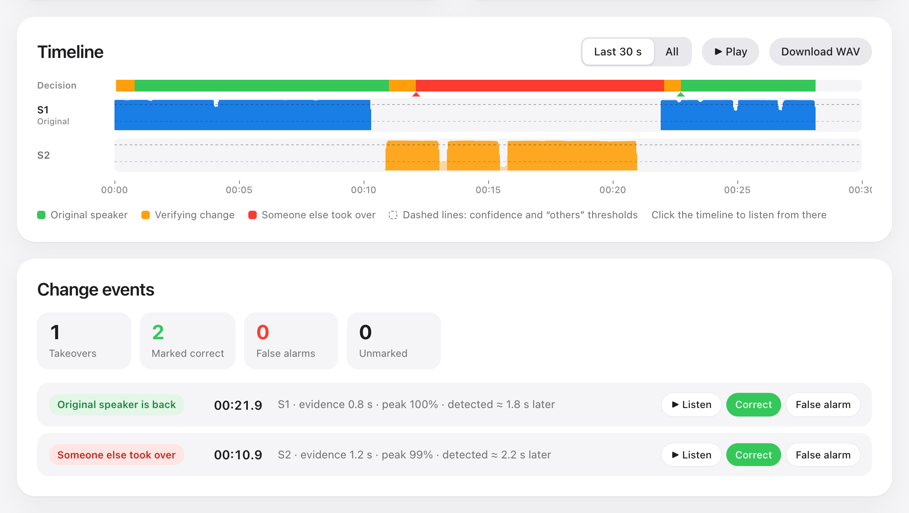

<p align="right"><b>English</b> · <a href="README.tr.md">Türkçe</a></p>

# Speaker Takeover Detector

**Is the person who started the conversation still the one talking?**

Speaker Takeover Detector detects speaker takeovers in real time with NVIDIA's [Nemotron-3-Diarization](https://huggingface.co/nvidia/Nemotron-3-Diarization). Everything runs in the browser on WebGPU. There is no server and no upload, so audio never leaves your device.

<p align="center">
  <a href="https://mehmetuzel.github.io/speaker-takeover-detector/"><b>▶&nbsp; Open the live demo</b></a><br>
  <sub>mehmetuzel.github.io/speaker-takeover-detector · Chrome, Edge or Safari 26+ · about 120 MB on first visit</sub>
</p>

<p align="center">
  
</p>

> The interface is in English by default. Use the **EN / TR** switch in the top bar for Turkish; the choice is remembered.

## Why

The person who answers a phone call is not always the person who keeps talking. The phone gets handed to a relative, a colleague takes over, or someone else in the room joins in. For a voice agent or a call-analysis pipeline this matters, because identity checks, consent and commitments usually belong to the first speaker.

This tool answers one narrow question, continuously: **is the current speech still coming from the first speaker?** Above all, it is built to avoid false alarms, meaning a claim that someone else took over while it is still the same person.

## How it works

<p align="center"></p>

1. **Input.** Audio from the microphone or a file is resampled to 16 kHz. For A/B tests it can first pass through noise suppression.
2. **Features.** 128-band log-mel spectrogram with 10 ms frames.
3. **Model.** Nemotron-3-Diarization is a Sortformer with about 100 M parameters, run here in streaming mode. Each 0.72 s chunk, plus 0.32 s of look-ahead, goes through the encoder together with an *arrival-order speaker cache* and a FIFO of recent frames, so speakers keep their identity from chunk to chunk. The output is an activity probability for up to 8 speakers every 10 ms. Speakers are numbered in order of first appearance, so **S1 is always whoever spoke first**.
4. **Decision.** A small rule layer turns the probabilities into one of three states: *original speaker*, *verifying a change* or *someone else took over*.

The model, an int8 ONNX file of about 120 MB, is downloaded once from Hugging Face and then served from the browser cache.

## Avoiding false alarms

<p align="center"></p>

- A 10 ms frame counts as **evidence** only when exactly one speaker is above the *confidence* threshold and every other speaker is below the *others* threshold.
- Silence, weak speech and overlapping speech never count as evidence.
- A change is confirmed only after **uninterrupted evidence** lasts for a minimum time. Gaps up to 300 ms are tolerated by default.
- The switch back to the original speaker follows the same rule, with its own minimum time.

| Preset | Confidence | Others at most | Evidence for takeover | Evidence for return | Typical detection time* |
| --- | --- | --- | --- | --- | --- |
| Balanced | 70% | 40% | 0.6 s | 0.4 s | ≈ 1.6 s |
| **Strict** (default) | 85% | 30% | 1.2 s | 0.8 s | ≈ 2.2 s |
| Very strict | 93% | 20% | 2.0 s | 1.2 s | ≈ 3.0 s |

<sub>* 1.04 s model input buffer plus the evidence time. Lower-latency model modes (0.64 s and 0.32 s) can be selected in the UI.</sub>

The thresholds are applied to the stored model output, so changing them re-evaluates the whole timeline instantly without running the model again.

## Accuracy and speed

The JavaScript streaming engine ([`diar-core.js`](diar-core.js)) is a port of the 🤗 transformers implementation. It was compared frame by frame with the PyTorch reference (transformers, streaming *low latency* mode) on 5 clips of 13–98 s. The clips are synthetic two-speaker recordings plus a public test recording with 5 or more speakers.

| Model file | Max. probability difference | Frames with the same decision (p > 0.5) | Takeover events |
| --- | --- | --- | --- |
| fp32 ONNX (Node.js) | 0.0000 | 100% | identical |
| **int8 ONNX, browser WebGPU (used)** | ≤ 0.016 | ≥ 99.98% | identical |
| 4-bit ONNX | ≤ 0.27 | 99.59%; 117 frames with a different dominant speaker on the 5-speaker clip | not used |

<p align="center"></p>

On an Apple M1 Pro with WebGPU, the model output trails live audio by roughly 0.4–1.1 s (input buffer plus compute).

## Try it



1. Open the [demo](https://mehmetuzel.github.io/speaker-takeover-detector/) in Chrome, Edge or Safari 26+. The first visit downloads about 120 MB.
2. **False-alarm test (the important one).** Choose *Microphone* and click *Start listening*, then talk alone for 1–2 minutes: normally, loudly, whispering, laughing, coughing, near and far from the mic. No red event should appear. If one does, mark it *False alarm*.
3. **Real takeover.** Start talking, then hand the microphone to someone else. The status should turn red, then green again when you take over.
4. **Recordings.** Choose *File* and pick a recording. For a stereo call recording, select the caller's channel so the agent's voice does not become S1.
5. **Noise suppression A/B.** Repeat the same scenario with *Off*, *Browser* and *RNNoise* and compare the false-alarm counts.

Ready-made clips are in [`samples/`](samples/). They were generated with macOS text-to-speech, so test with real voices too.

<br clear="right">

<p align="center"></p>

## Noise suppression and voice isolation

*Browser* turns on the browser's built-in WebRTC noise suppression, which applies to the microphone only. *RNNoise* runs the open-source RNNoise model on your device. Both remove noise but also change the voice, which can help or hurt, so measure it.

*Voice isolation* products, such as Krisp's voice isolation, are different: they keep one primary voice and remove the others as background speech. That second voice is exactly what a takeover detector has to hear. If your pipeline uses voice isolation, run takeover detection on the audio **before** the isolation step.

## Browser support

- **Live use needs WebGPU:** Chrome and Edge on desktop and Android, or Safari 26+.
- Without WebGPU the page falls back to WebAssembly. That is about 8× slower than real time on an M1 Pro: usable for short files, not for live use.
- URL options: `?lang=tr` opens the Turkish interface; `?backend=wasm` forces WebAssembly; `?precision=fp16` or `?precision=fp32` loads the larger model files.

## Run locally

```bash
git clone https://github.com/MehmetUzel/speaker-takeover-detector.git
```

```bash
cd speaker-takeover-detector && python3 -m http.server 8000
```

Then open http://localhost:8000. Browsers treat `localhost` as a secure context, so the microphone and WebGPU work there.

## Project layout

| File | Purpose |
| --- | --- |
| `index.html` | UI (English and Turkish), timeline and the decision layer |
| `worker.js` | Web Worker: downloads and caches the model, runs ONNX Runtime Web, resampling and RNNoise |
| `diar-core.js` | Streaming engine: log-mel front end, speaker cache + FIFO, chunking |
| `worklet.js` | AudioWorklet microphone capture |
| `mel_filters.bin` | 128 × 257 Slaney mel filterbank, exported from the reference feature extractor |
| `samples/` | Test clips |
| `docs/` | README images (`en/`, `tr/`) |

## Credits and licenses

- **Model:** [NVIDIA Nemotron-3-Diarization](https://huggingface.co/nvidia/Nemotron-3-Diarization), under the OpenMDW License 1.1. The weights are not stored in this repository; the browser downloads the [onnx-community export](https://huggingface.co/onnx-community/Nemotron-3-Diarization-ONNX).
- **Streaming engine:** a port of the Nemotron3Diarization implementation in [🤗 transformers](https://github.com/huggingface/transformers) (Apache-2.0).
- **Runtime:** [ONNX Runtime Web](https://onnxruntime.ai/) (MIT); [RNNoise](https://github.com/xiph/rnnoise) (BSD-3-Clause) through [@shiguredo/rnnoise-wasm](https://github.com/shiguredo/rnnoise-wasm) (Apache-2.0). Both load from jsDelivr.
- Thanks to Neal Caren's notes on running Nemotron-3-Diarization with ONNX Runtime Web, which showed that the browser route was practical.
- Code in this repository: [Apache-2.0](LICENSE).

This is an unofficial project and is not affiliated with NVIDIA.
