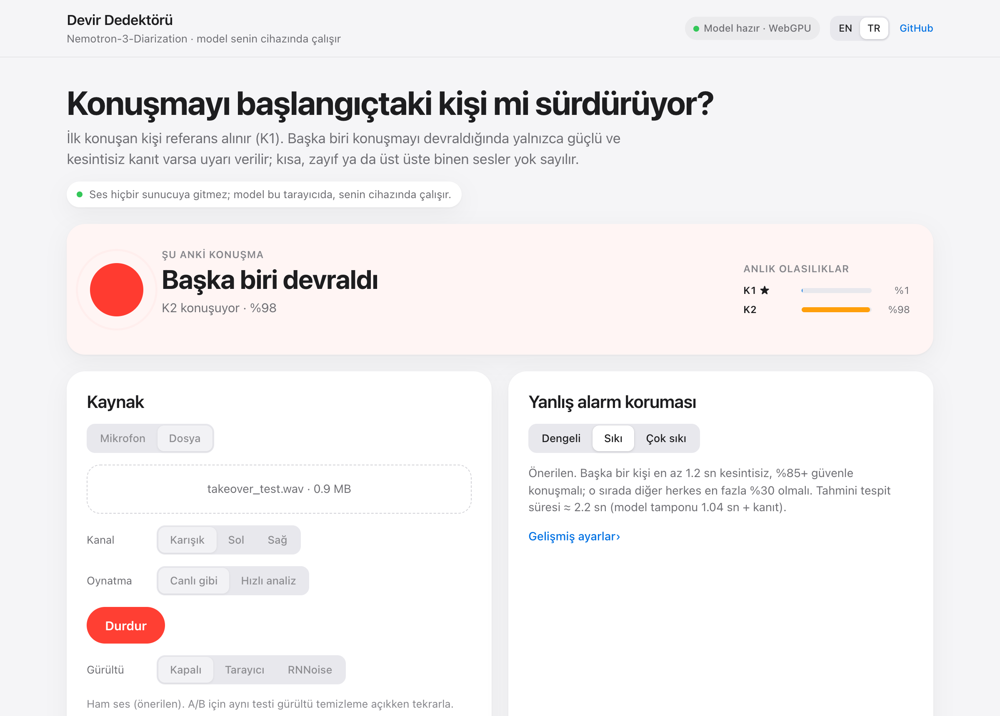
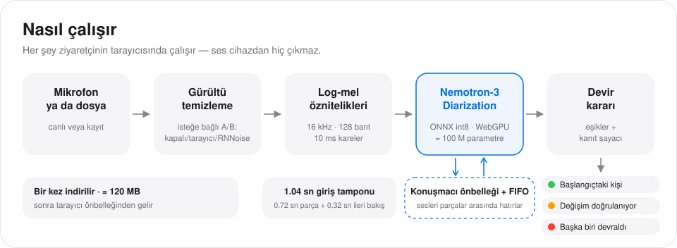
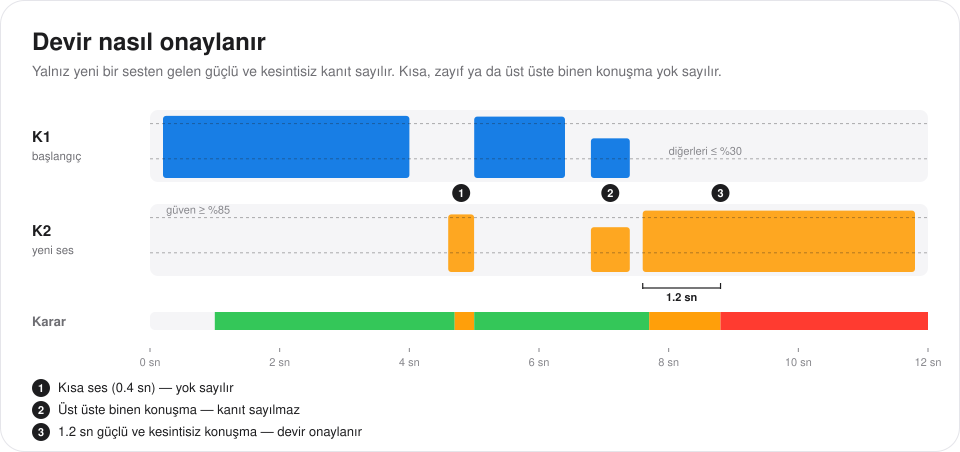
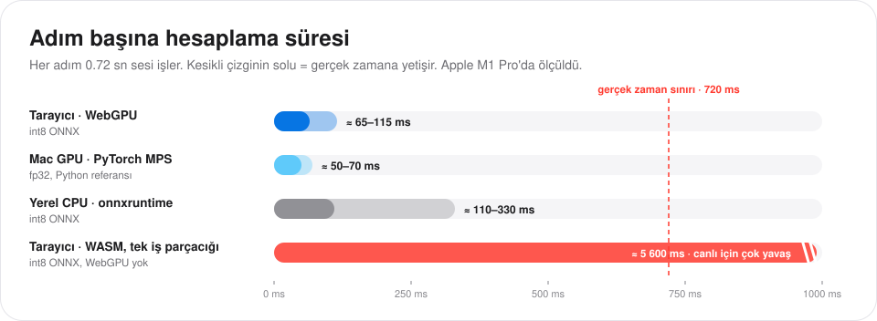
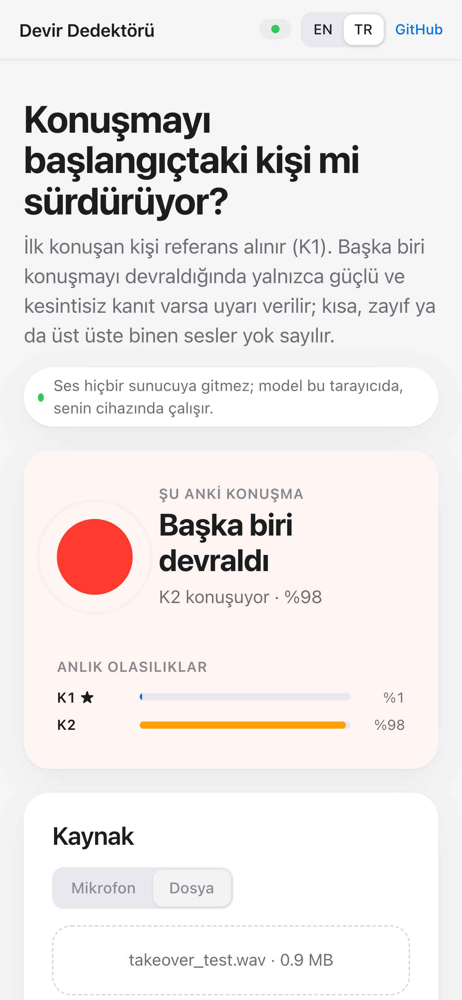
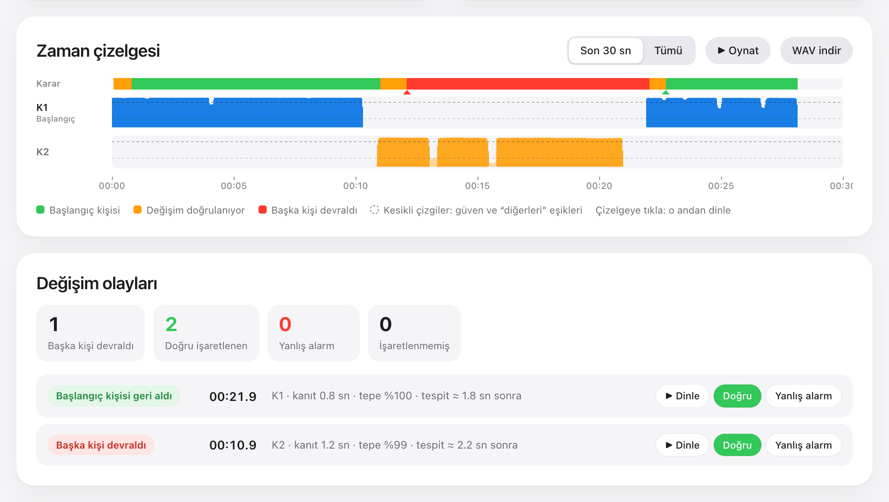

<p align="right"><a href="README.md">English</a> · <b>Türkçe</b></p>

# Devir Dedektörü (Speaker Takeover Detector)

**Konuşmayı başlangıçtaki kişi mi sürdürüyor?**

Devir Dedektörü, NVIDIA'nın [Nemotron-3-Diarization](https://huggingface.co/nvidia/Nemotron-3-Diarization) modeliyle konuşmacı devrini gerçek zamanlı tespit eder. Her şey tarayıcıda, WebGPU üzerinde çalışır. Sunucu da yükleme de yoktur; ses cihazından hiç çıkmaz.

<p align="center">
  <a href="https://mehmetuzel.github.io/speaker-takeover-detector/?lang=tr"><b>▶&nbsp; Canlı demoyu aç</b></a><br>
  <sub>mehmetuzel.github.io/speaker-takeover-detector · Chrome, Edge ya da Safari 26+ · ilk ziyarette yaklaşık 120 MB</sub>
</p>

<p align="center">
  
</p>

> Arayüz varsayılan olarak İngilizcedir. Üst bardaki **EN / TR** düğmesiyle Türkçeye geçebilirsin; seçim tarayıcıda hatırlanır. Yukarıdaki link doğrudan Türkçe açılır.

## Neden

Telefonu açan kişi her zaman konuşmayı sürdüren kişi olmaz. Telefon bir yakına verilir, bir iş arkadaşı devralır ya da ortamdaki başka biri söze karışır. Sesli asistanlar ve çağrı analizi için bu önemlidir, çünkü kimlik doğrulama, onay ve verilen sözler genelde ilk konuşan kişiye aittir.

Bu araç tek bir soruyu sürekli yanıtlar: **şu anki konuşma hâlâ ilk konuşan kişiden mi geliyor?** Önceliği yanlış alarm vermemektir, yani aynı kişi konuşurken "başka biri devraldı" dememektir.

## Nasıl çalışır

<p align="center"></p>

1. **Giriş.** Mikrofondan ya da dosyadan gelen ses 16 kHz'e çevrilir. A/B testi için önce gürültü temizlemeden geçirilebilir.
2. **Öznitelikler.** 128 bantlı log-mel spektrogramı, 10 ms'lik kareler.
3. **Model.** Nemotron-3-Diarization yaklaşık 100 M parametreli bir Sortformer'dır ve burada streaming modda çalışır. Her 0.72 sn'lik parça, 0.32 sn ileri bakışla birlikte, *geliş sırasına göre konuşmacı önbelleği* ve son karelerin tutulduğu bir FIFO ile encoder'dan geçer. Böylece konuşmacılar parçadan parçaya kimliklerini korur. Çıktı, her 10 ms için en fazla 8 konuşmacının konuşma olasılığıdır. Konuşmacılar ilk duyulma sırasına göre numaralanır; **K1 her zaman ilk konuşan kişidir**.
4. **Karar.** Küçük bir kural katmanı olasılıkları üç durumdan birine çevirir: *başlangıçtaki kişi*, *değişim doğrulanıyor* ya da *başka biri devraldı*.

Model, yaklaşık 120 MB'lık int8 ONNX dosyası, Hugging Face'ten bir kez indirilir; sonra tarayıcı önbelleğinden gelir.

## Yanlış alarmı önleme

<p align="center"></p>

- Bir 10 ms'lik kare ancak tek bir konuşmacı *güven* eşiğinin üstündeyken ve diğer herkes *diğerleri* eşiğinin altındayken **kanıt** sayılır.
- Sessizlik, zayıf ses ve üst üste binen konuşma hiçbir zaman kanıt sayılmaz.
- Değişim ancak **kesintisiz kanıt** belirli bir süre boyunca toplanınca onaylanır. Varsayılan ayarda 300 ms'ye kadar boşluk sayacı sıfırlamaz.
- Başlangıç kişisine dönüş de aynı kurala, kendi süresiyle bağlıdır.

| Ön ayar | Güven | Diğerleri en fazla | Devir için kanıt | Dönüş için kanıt | Tipik tespit süresi* |
| --- | --- | --- | --- | --- | --- |
| Dengeli | %70 | %40 | 0.6 sn | 0.4 sn | ≈ 1.6 sn |
| **Sıkı** (varsayılan) | %85 | %30 | 1.2 sn | 0.8 sn | ≈ 2.2 sn |
| Çok sıkı | %93 | %20 | 2.0 sn | 1.2 sn | ≈ 3.0 sn |

<sub>* 1.04 sn model giriş tamponu artı kanıt süresi. Arayüzden daha düşük gecikmeli model modları (0.64 sn ve 0.32 sn) seçilebilir.</sub>

Eşikler saklanan model çıktısına uygulanır. Bu yüzden eşik değişince model yeniden çalışmaz; tüm çizelge anında yeniden değerlendirilir.

## Doğruluk ve hız

JavaScript streaming motoru ([`diar-core.js`](diar-core.js)), 🤗 transformers uygulamasının bir uyarlamasıdır. PyTorch referansıyla (transformers, streaming *low latency* modu) 13–98 sn'lik 5 kayıtta kare kare karşılaştırıldı. Kayıtlar sentetik iki konuşmacılı kayıtlar ile 5'ten fazla konuşmacılı herkese açık bir test kaydıdır.

| Model dosyası | En büyük olasılık farkı | Aynı karar verilen kareler (p > 0.5) | Devir olayları |
| --- | --- | --- | --- |
| fp32 ONNX (Node.js) | 0.0000 | %100 | birebir aynı |
| **int8 ONNX, tarayıcı WebGPU (kullanılan)** | ≤ 0.016 | ≥ %99.98 | birebir aynı |
| 4-bit ONNX | ≤ 0.27 | %99.59; 5 konuşmacılı kayıtta 117 karede baskın konuşmacı farklı | kullanılmıyor |

<p align="center"></p>

Apple M1 Pro'da WebGPU ile model çıktısı canlı sesin yaklaşık 0.4–1.1 sn gerisinden gelir (giriş tamponu artı hesaplama).

## Deneme



1. [Demoyu](https://mehmetuzel.github.io/speaker-takeover-detector/?lang=tr) Chrome, Edge ya da Safari 26+ ile aç. İlk ziyarette yaklaşık 120 MB indirilir.
2. **Yanlış alarm testi (en önemlisi).** *Mikrofon*'u seç ve *Dinlemeyi başlat*'a bas. 1–2 dakika tek başına konuş: normal, yüksek sesle, fısıltıyla, gülerek, öksürerek, mikrofona uzak ve yakın. Hiç kırmızı olay çıkmamalı; çıkarsa *Yanlış alarm* ile işaretle.
3. **Gerçek devir.** Sen başla, sonra mikrofonu başka birine ver. Durum kırmızıya dönmeli; sen tekrar konuşunca yeşile dönmeli.
4. **Kayıtlar.** *Dosya*'yı seçip bir kayıt yükle. Stereo çağrı kaydında arayan kişinin kanalını seç ki asistanın sesi K1 olmasın.
5. **Gürültü A/B.** Aynı senaryoyu *Kapalı*, *Tarayıcı* ve *RNNoise* ile tekrarlayıp yanlış alarm sayılarını karşılaştır.

Hazır kayıtlar [`samples/`](samples/) klasöründe. macOS'un metinden sese özelliğiyle üretildiler; gerçek seslerle de test et.

<br clear="right">

<p align="center"></p>

## Gürültü temizleme ve ses izolasyonu

*Tarayıcı* seçeneği tarayıcının kendi WebRTC gürültü bastırmasını açar ve yalnız mikrofonda geçerlidir. *RNNoise* açık kaynak RNNoise modelini cihazında çalıştırır. İkisi de gürültüyü azaltır ama sesi de değiştirir; bu faydalı da olabilir zararlı da, bu yüzden ölçmek gerekir.

*Ses izolasyonu* ürünleri (örneğin Krisp'in ses izolasyonu) farklıdır: tek bir ana sesi tutup diğer sesleri arka plan konuşması olarak siler. Oysa devir dedektörünün duyması gereken tam olarak o ikinci sestir. Sisteminizde ses izolasyonu varsa devir tespitini izolasyondan **önceki** ses üzerinde yapın.

## Tarayıcı desteği

- **Canlı kullanım için WebGPU gerekir:** masaüstü ve Android'de Chrome ve Edge ya da Safari 26+.
- WebGPU yoksa sayfa WebAssembly ile çalışır. Bu, M1 Pro'da gerçek zamandan yaklaşık 8 kat yavaştır: kısa dosyalar için kullanılabilir, canlı kullanım için değil.
- URL seçenekleri: `?lang=tr` Türkçe arayüzü açar; `?backend=wasm` WebAssembly'yi zorlar; `?precision=fp16` ya da `?precision=fp32` daha büyük model dosyalarını yükler.

## Yerelde çalıştırma

```bash
git clone https://github.com/MehmetUzel/speaker-takeover-detector.git
```

```bash
cd speaker-takeover-detector && python3 -m http.server 8000
```

Sonra http://localhost:8000 adresini aç. Tarayıcılar `localhost`'u güvenli bağlam saydığı için mikrofon ve WebGPU orada da çalışır.

## Dosyalar

| Dosya | Görevi |
| --- | --- |
| `index.html` | Arayüz (İngilizce ve Türkçe), zaman çizelgesi ve karar katmanı |
| `worker.js` | Web Worker: modeli indirip önbelleğe alır, ONNX Runtime Web'i, örnekleme dönüşümünü ve RNNoise'u çalıştırır |
| `diar-core.js` | Streaming motoru: log-mel, konuşmacı önbelleği + FIFO, parçalama |
| `worklet.js` | AudioWorklet ile mikrofon yakalama |
| `mel_filters.bin` | 128 × 257 Slaney mel filtre bankası, referans öznitelik çıkarıcıdan dışa aktarıldı |
| `samples/` | Test kayıtları |
| `docs/` | README görselleri (`en/`, `tr/`) |

## Katkılar ve lisanslar

- **Model:** [NVIDIA Nemotron-3-Diarization](https://huggingface.co/nvidia/Nemotron-3-Diarization), OpenMDW License 1.1 lisansıyla. Ağırlıklar bu repoda tutulmaz; tarayıcı [onnx-community dışa aktarımını](https://huggingface.co/onnx-community/Nemotron-3-Diarization-ONNX) indirir.
- **Streaming motoru:** [🤗 transformers](https://github.com/huggingface/transformers) içindeki Nemotron3Diarization uygulamasının uyarlaması (Apache-2.0).
- **Çalışma ortamı:** [ONNX Runtime Web](https://onnxruntime.ai/) (MIT); [RNNoise](https://github.com/xiph/rnnoise) (BSD-3-Clause), [@shiguredo/rnnoise-wasm](https://github.com/shiguredo/rnnoise-wasm) (Apache-2.0) üzerinden. İkisi de jsDelivr'dan yüklenir.
- Nemotron-3-Diarization'ı ONNX Runtime Web ile çalıştırma notları tarayıcı yolunun uygulanabilir olduğunu gösterdiği için Neal Caren'a teşekkürler.
- Bu repodaki kod: [Apache-2.0](LICENSE).

Bu resmî olmayan bir projedir ve NVIDIA ile bağlantısı yoktur.
